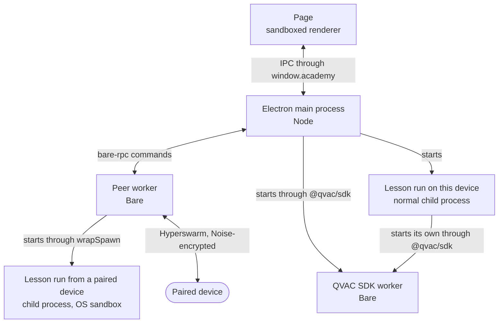
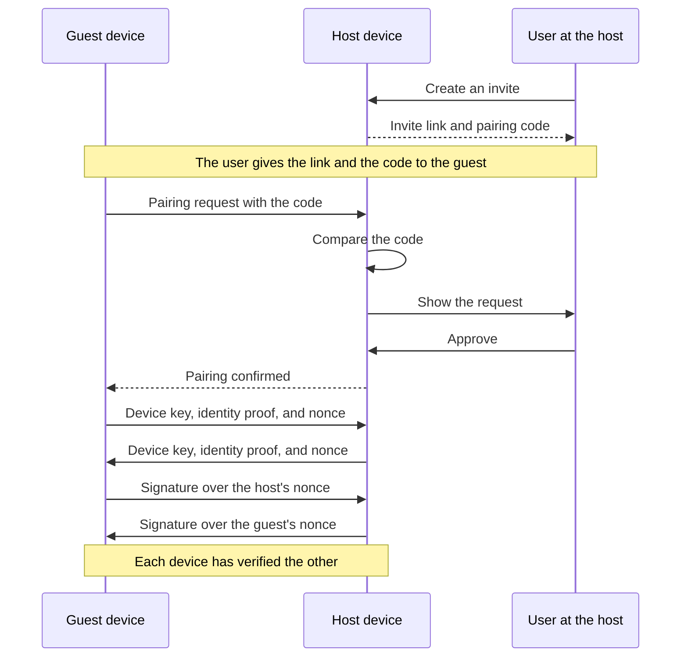
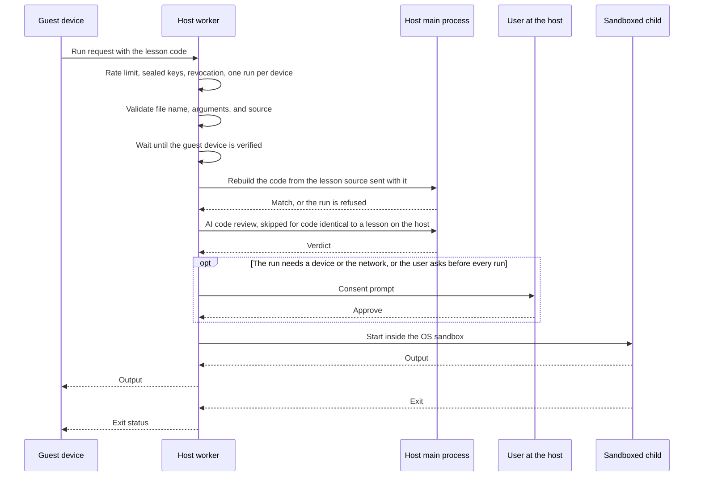

# P2P Academy architecture

Last update: Oct 13, 2026

Related documents and links

- [Security boundaries](SECURITY-BOUNDARIES.md): what enforces each trust boundary.
- [Repository layout](../repository-layout.md): apps, packages, and where to make common changes.
- [Configuration](../configuration.md): flags, environment variables, and limits.
- [Testing](../testing.md): test suites and how to run them.
- [Desktop conventions](../conventions/desktop-conventions.md): code rules for the desktop app.

If a statement on this page disagrees with the file it points at, the file wins.

## Product executive summary

P2P Academy is an interactive code school for the Tether product suite. The repository has three apps:

- The web app (`apps/web`) is the lesson site and the workspace UI, built as a static export.
- The desktop app (`apps/desktop`) is an Electron shell around that same build. It runs lessons on this device, pairs with other devices, and runs lessons a paired device sends.
- The CLI (`apps/cli`) installs, updates, and starts the desktop app.

The core execution model of the desktop app:

- The page reaches the main process only through `window.academy`, a fixed set of IPC channels with a schema each.
- The Electron main process owns identity, storage, and model management.
- A separate Bare worker process owns pairing, the peer mesh, and remote code execution.
- Lesson code runs in child processes. A run on this device is a normal process, and a run a paired device sent starts only inside the OS sandbox.
- Lessons use the QVAC SDK (`@qvac/sdk`) for local AI inference, with models cached in `~/.qvac/models/`.

## Container diagram

In this diagram, a container is a running process. The desktop app runs as these processes. Each arrow is the only way the two sides talk. Electron's own helper processes are not shown.

| Process | What it owns | Entry point |
| :--- | :--- | :--- |
| Page | The lesson site and workspace UI, loaded from `apps/web/out` on the `academy://app/` origin | `electron/preload.js` exposes `window.academy` to it |
| Electron main process | The window, the IPC registry, identity, the key-value store, and model management | `electron/main.js` |
| Peer worker | Pairing, the peer mesh, and remote runs | `workers/entry.cjs` |
| Lesson run on this device | One lesson the user started with Run | `runner.cjs` |
| Lesson run from a paired device | One lesson a paired device sent | `workers/sandbox/index.cjs` wraps it |
| QVAC SDK worker | Model loading and inference for the process that started it. The main process has one for the AI bot and the playground, and a lesson run on this device starts its own | `@qvac/sdk` starts it |

The main process reaches identity, storage, and the worker through one facade, [`pear-end/index.cjs`](../../apps/desktop/electron/pear-end/index.cjs), and starts the worker through [`worker-client.cjs`](../../apps/desktop/electron/pear-end/worker-client.cjs). The command IDs the two exchange are in [`rpc-commands.cjs`](../../apps/desktop/shared/rpc-commands.cjs). Identity and the key-value store stay in the main process.

When the worker exits without being asked to while the mesh is running, `worker-client.cjs` starts a new one and sends it the last `INIT` arguments, with the list of revoked devices brought up to date. A call made while the worker is down fails with the `WORKER_EXITED` error code. After repeated crashes it stops restarting, and the next `ensureReady()` call in `pear-end/index.cjs` starts a fresh worker. [Configuration](../configuration.md#limits-fixed-in-source) has the restart limits.

## Component overview

The desktop app uses these libraries and runtimes:

- Electron 44 is the desktop shell. A `BrowserWindow` renders the static export the web app produces, and `contextBridge` is the only way the page reaches the main process.
- Next.js 15 and Fumadocs build the lesson site and the workspace UI as a static export, so the web deployment and the desktop shell load the same build.
- Pear Runtime (`pear-runtime`) starts a Bare worker process from the Electron main process.
- Bare is the JavaScript runtime the peer code runs in. It runs as its own process.
- Hyperswarm provides peer discovery and a Noise-encrypted transport for pairing and remote runs. Paired devices talk to each other without a server.
- Corestore and Hypercore provide local storage. The app's key-value store is a log on one Hypercore ([`kv-core.cjs`](../../apps/desktop/electron/kv-core.cjs)).
- `blind-pairing` provides the pairing invites.
- `keet-identity-key` provides the root identity and the per-device keys derived under it. [`identity/manager.cjs`](../../apps/desktop/electron/identity/manager.cjs) seals them at rest.
- The QVAC SDK (`@qvac/sdk`) provides local AI inference. The lessons teach it, and a lesson run loads it.

## Pairing flow

To pair, two devices need an invite, a pairing code, the host user's approval, and an identity handshake. [Security boundaries](SECURITY-BOUNDARIES.md#peer-to-peer) describes each check.

## Remote run flow

A paired device sends a lesson for this device to run. The host checks the request, reviews the code, asks for consent when the run needs a device or the network, or for every run from a device the user set to ask, and starts the code inside the OS sandbox. Any step can refuse the run, and the guest then gets a fixed error code.

## Security model

| Boundary | Mechanism |
| --- | --- |
| Renderer to main process | Sandboxed renderer, a fixed IPC channel registry, a schema per channel, sender check on every invocation |
| Main process to peer worker | Separate Bare process, one `bare-rpc` command per action, command fields checked in the worker |
| Local lesson runs | None. The lesson runs as a normal process, like a script started from a terminal |
| Peer to peer | Noise-encrypted transport, pairing code, identity proof and signature, size cap and field check on every message, rate limits, OS sandbox for remote code |
| Installer and updates | HTTPS clone of this repository, frozen lockfile, SHA-256 checks on the tools the Windows installer downloads |
| Model downloads | SHA-256 and size checks before a file enters the model cache, HTTPS only |

[Security boundaries](SECURITY-BOUNDARIES.md) describes what enforces each row, and what the sandbox guarantees on each platform.

## Failure modes

| Symptom | Where to look |
| --- | --- |
| Devices never connect | The invite, whether the swarm joined, and the key |
| Devices connect but no pairing prompt appears | Event routing in `pear-end/index.cjs` and the page's `peer.onEvent` listener |
| A remote run is refused at once | The refusal code from `exec-host.cjs` (`PEER_ERROR_TEXT` lists them) and the sandbox warnings in the log |
| A remote run is cancelled after a long silence | The idle limit, `PEER_EXEC_IDLE_MS` in `electron/main.js` |
| A model fails to parse from the cache | `shared/model-integrity.cjs` and the `academy:models:verify` channel |
| The page shows stale pairing state | The `academy:peer:event` subscription in `preload.js` |
| Peer calls fail with `WORKER_EXITED` | The `peer:worker-exited` and `peer:worker-restarted` events, and the `[pear-end worker]` lines in the log |

## Cross-cutting concerns

- Both process boundaries register one fixed command per action, each with a schema. `shared/ipc-channels.cjs` lists the commands between the page and the main process, and `shared/rpc-commands.cjs` lists those between the main process and the worker. Neither boundary has a generic "invoke this method" command.
- Messages between two devices follow the same pattern. `workers/peer/peer-messages.cjs` lists every message kind with the exact fields it allows, and the worker drops a frame of any other kind.
- `exec-host.cjs` refuses a remote run unless the OS sandbox is active. A separate detection step produces what the user reads in the consent prompt.
- [`capabilities.cjs`](../../apps/desktop/workers/sandbox/capabilities.cjs) declares file, network, executable, and device access as data, and the module for each platform turns that data into a sandbox profile.
- A remote run that needs a device or the network prompts on every run, including from a device that is already paired and verified. A run that needs neither prompts only when the user turned on "Always ask before running" for that pairing.
- `pear-end/index.cjs` owns the identity, storage, and peer lifecycle for the main process, as one facade.
- `electron/main.js` registers each long-lived service of the main process (the pear-end worker, the QVAC SDK worker, and each model) with the function that releases it, in [`services.cjs`](../../apps/desktop/electron/services.cjs). A name can be registered once until it is disposed. On quit, the main process disposes every service in reverse registration order, and one failure does not stop the rest.

## Repositories

The apps are under `apps/` and the shared packages under `packages/`, all in this repository. [Repository layout](../repository-layout.md) has the table of each app and package and the desktop app's files.
